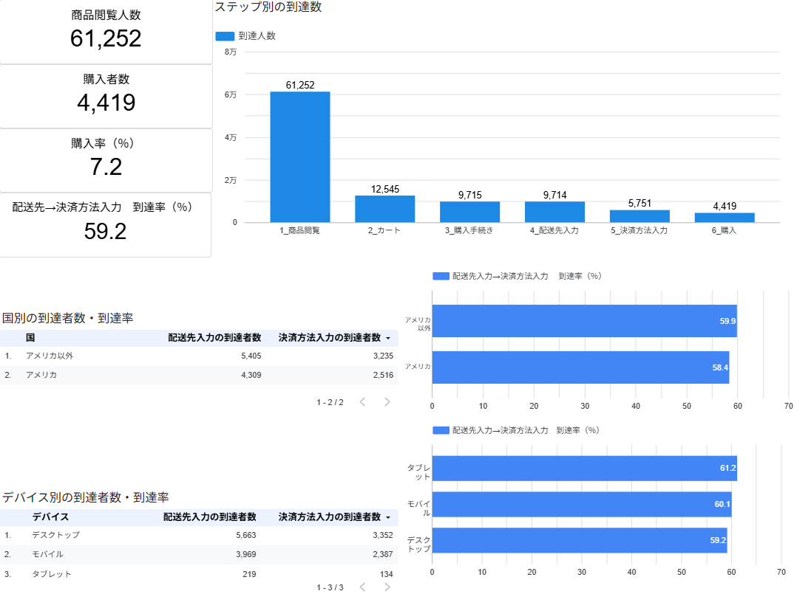

# GA4 ECサイトのファネル分析(配送先入力→決済方法入力の離脱)

ダッシュボード:[Looker Studioで見る](https://datastudio.google.com/reporting/2622ee51-e0ef-4960-9e56-24cfc83aec76/page/TlfBG)

## 概要

BigQueryで公開されているGA4のサンプルデータ(Googleの公式グッズを販売するECサイト)を使い、商品閲覧から購入までのどの段階でユーザーが離脱しているのかを分析しました。

## 問い

配送先入力まで進んだ購入意欲の高いユーザーのうち、約4割が決済方法入力に進まないのはなぜなのか。

## データと条件

- **データ**:BigQuery公開データセット「GA4 Google Merchandise Store サンプル」(ga4_obfuscated_sample_ecommerce)
- **期間**:2020年11月1日〜2021年1月31日(92日間)
- **使用した列**:user_pseudo_id(ユーザー)、event_name(イベント)、device.category(端末)、geo.country(国)
- **対象イベント**:商品閲覧から購入完了までの6つ
  view_item(商品閲覧)→ add_to_cart(カート)→ begin_checkout(購入手続き)→ add_shipping_info(配送先入力)→ add_payment_info(決済方法入力)→ purchase(購入)
- **数え方**:各段階の人数は「期間中に一度でもそのイベントをしたユーザー」の数
- **国の分け方**:「アメリカ」と「アメリカ以外」の2つに分けて比較

**分析前に確認したこと**

- user_pseudo_id に空欄(NULL)がないか → 0行
- 期間内に抜けている日がないか → 92日すべてにデータあり
- 段階を飛ばして購入した人が多くないか → 購入者4,419人のうち4,418人が決済方法入力も済ませていた

**注意点**

- 端末別の人数は、複数の端末(スマホとPCなど)を使ったユーザーをそれぞれの端末で数えているため、合計は全体の人数と一致しない

## 使用ツール

**BigQuery(SQL)**

- WITH:クエリを段階ごとに分けて読みやすくするため
- CASE WHEN:イベント名を日本語の段階名にするため。また、国をそのまま出すと到達者が1人しかいない国の到達率が100%になってしまうため、「アメリカ」と「アメリカ以外」の2つにまとめるため
- COUNT(DISTINCT CASE WHEN):同じユーザーを重複して数えないようにするため
- MAX(CASE WHEN) / SUM:ユーザーごとに「そのイベントをした=1、していない=0」のフラグを付け、合計して人数を出すため
- SAFE_DIVIDE:分母が0のときに「/」で割ると出てしまうエラーを防ぐため
- ROUND:整数にすると細かい違いが分からなくなるため、到達率を小数第1位まで出す
- MIN / MAX / COUNT(DISTINCT event_date):データの期間と、抜けている日がないかを確認するため

**Looker Studio**

- 棒グラフ:商品閲覧から購入までの段階別の到達人数と、国別・端末別の到達率を見せるため
- 表:国別・端末別の配送先入力と決済方法入力の到達者数を見せるため
- スコアカード:特に見てほしい主要な数字(KPI)を示すため

**GitHub**:SQLとREADMEの公開

## 分かったこと

- **国別**:到達率はアメリカ58.4%、アメリカ以外59.9%で、差は1.5ポイントとほとんど変わらなかった
- **端末別**:デスクトップ59.2%、モバイル60.1%、タブレット61.2%で、差は最大2.0ポイントとほとんど変わらなかった
  - タブレットは到達者数が219人と他の端末より少なく割合がぶれやすいため、最も高いことに意味があるとは言い切れない
- **結論**:「国によって使える決済方法が違う」「端末によって操作しにくい」という仮説はどちらも支持されなかった。国や端末に関係なく離脱していることから、支払い画面そのものに原因がある可能性がある

## 工夫した点・苦労した点

**1. 国の分け方**

最初に国別の到達者数と到達率を一緒に出したところ、到達者数1人・到達率100%の国が目に入り、人数の少ない国では割合に意味がなくなると気づいた。アメリカ1国で配送先入力の到達者の約44%を占めていたため、CASE WHENで「アメリカ」と「アメリカ以外」の2つにまとめて比較した。

**2. 分析前のデータ確認**

ファネルは段階を順番に進むことが前提のため、決済方法入力を飛ばして購入している人が多いと数字に影響してしまう。そこで、MAX(CASE WHEN)でユーザーごとに「そのイベントをした=1、していない=0」のフラグを付け、外側のクエリでSUMで合計して確認した。購入者4,419人のうち4,418人が決済方法入力も済ませており、ほぼ全員が順番どおりに進んでいることを確かめた。

**3. ダッシュボードの見やすさ**

最初は人数と到達率を1つの表(棒グラフ付き)にまとめていたが、情報が詰まって見にくく、グラフも小さくて役に立っていなかった。そこで到達率だけを横棒グラフに分け、表には到達者数、グラフには到達率と役割を分けて読み取りやすくした。

## 今後の改善

**次に調べたいこと**

- 決済画面でエラーが起きていないか、開発担当にエラー数・エラー率を確認する
- 配送先入力の後に表示される送料・合計金額が、離脱の原因になっていないかを調べる

**分析の限界**

- タブレットは到達者数が219人と少なく割合がぶれやすいため、期間を長くして人数を増やしたうえで確かめる必要がある
- 期間(11月〜1月)は年末の買い物シーズンにあたるため、他の時期でも同じ結果になるかは分からない
- 今回のデータで分かるのは「どこで離れたか」までで、「なぜ離れたか」は推測にとどまる

## SQL

**分析前のデータ確認**

- [user_pseudo_id に空欄(NULL)がないか](sql/data_check_01_null.sql)
- [データの期間と、抜けている日がないか](sql/data_check_02_dates.sql)
- [決済方法入力を飛ばして購入した人がいないか](sql/data_check_03_skip_steps.sql)

**分析**

- [段階別の到達人数](sql/ga4_01_funnel_users.sql)
- [国別の到達率](sql/ga4_02_reach_rate_by_country.sql)
- [端末別の到達率](sql/ga4_03_reach_rate_by_device.sql)
- [スコアカード用の主要な数字](sql/ga4_04_kpi_summary.sql)
