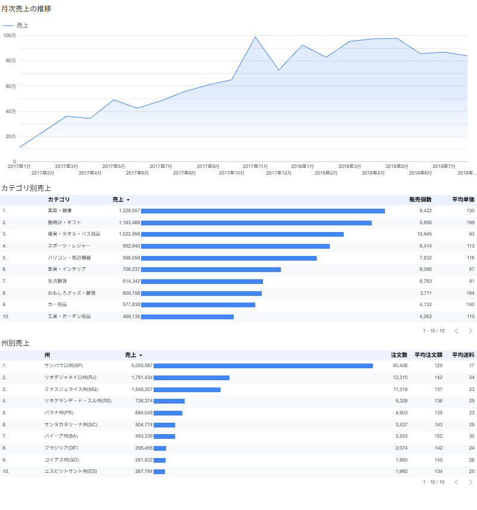

# Olist 売上ダッシュボード

ダッシュボード:[Looker Studioで見る](https://datastudio.google.com/reporting/5e74d9b7-a609-4640-bc0b-cf9966f811c5)

## 概要

kaggleのOlistにあるブラジルのECサイトの注文データを使用して、2017年1月から2018年8月の配達完了注文に絞り、月次売上の推移/カテゴリ別売上/州別売上・注文数・平均注文額・平均送料をSQLで集計・抽出し、Looker Studioで可視化しました。

## 目的・問い

EC業界のデータ分析者として、売上がどのように作られているかを分解し把握するため。

**問い**:売上の大きい地域は、注文数と平均注文額のどちらで売上を伸ばしているのか。また、平均注文額の違いは送料と関係しているのか。

## データと条件

使用テーブル:`orders` / `items` / `products` / `customers`

| 条件 | 理由 |
|---|---|
| ① 配達完了(`order_status = 'delivered'`)のみ | 実際に購入された注文のみの売上を見るため |
| ② 期間は2017年1月〜2018年8月 | 2016年と2018年9月以降はデータの収集開始・終了の時期で注文数が極端に少なく、増減率(+1,016,245%)が意味のない値になるため除外した |
| ③ 売上は商品代金のみ(送料は含めない) | 商品の売上と配送にかかるお金を分けるため |
| ④ 注文数は `COUNT(DISTINCT order_id)` で数える | 1つの注文の明細が複数行あり、そのまま数えると重複してしまうため |

## 使用ツール

**BigQuery(SQL)** ([SQLファイル](sql/))
- JOIN(必要なテーブルの結合)
- LAG(前の行の値を表示し、前月と当月の売上を比較)
- SAFE_DIVIDE(増減率を出すため)
- WITH(prev_salesを使用し増減率を求めるため)
- CASE(カテゴリ名・地域名を日本語で見やすく)

**Looker Studio**
- 時系列グラフ(月次売上)
- 表(カテゴリ別売上)
- 表(棒グラフ付き地域別売上)

**Excel**
- レポートの作成([州別売上レポート](images/excel_report.png))
- SQLの集計結果と検算し、一致を確認

## 分かったこと

### 地域別売上

- 売上1位のサンパウロ州と売上9位のゴイアス州の注文数を比較すると、サンパウロ州(40,406)が最多、ゴイアス州(1,950)が最低で、約21倍の差がある。
- 売上7位のバイーア州とサンパウロ州の平均注文額を比較すると、バイーア州(152)が最多、サンパウロ州(125)が最低で、約1.2倍の差がある。さらに平均送料もバイーア州が30、サンパウロ州が17と、バイーア州の方が高い。
- 以上のことから、「売上の多い地域は注文数で売上を伸ばしており、平均注文額は送料と関係している」可能性がある。

### 月次売上の推移

- 2017年11月に増減率+52%と大きく上昇しているが、おそらくブラックフライデーの影響を受けていると考えられる。

### カテゴリ別売上

| 順位 | カテゴリ | 売上 | 販売個数 | 平均単価 |
|---|---|---:|---:|---:|
| 1位 | 美容・健康 | 1,229,557 | 9,422 | 130 |
| 2位 | 腕時計・ギフト | 1,163,466 | 5,855 | 199 |
| 3位 | 寝具・タオル・バス用品 | 1,022,956 | 10,945 | 93 |

- 2位は単価で、3位は販売個数で売上が伸びている。

## 工夫した点・苦労した点

- OlistのデータがブラジルのECサイトだったので、地域やカテゴリ名が略語・ポルトガル語で書いてあり、報告相手を上司・クライアント先だと想定し、分かりやすいようにCASEを使用し日本語に変更した。
- 始めは期間の指定にBETWEENを使用したが、日時の取りこぼし・紛れ込みを防ぐため、WHERE内にて比較演算子を使用し、2017年1月以上・2018年9月未満と指定した。

## 今後の改善

- 送料とAOVは一緒に動いている傾向は見られたが、そこには住んでいる人の暮らしや収入などの要因もあるため、送料が原因でAOVが上がっているとは言い切れない。
- 送料無料ラインの施策を行うことで、損失回避したいという人の心がAOVの上昇に作用するのか、A/Bテストで検証する。

## SQL

- [月次売上・増減率](sql/01_monthly_sales.sql)
- [カテゴリ別売上・販売個数・平均単価](sql/02_category_sales.sql)
- [州別売上・注文数・平均注文額・平均送料](sql/03_state_sales.sql)
