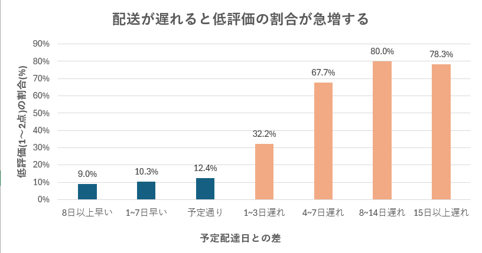

# 配送遅延とレビュー評価の関係分析

## 概要

ブラジルのECサイトOlistの公開データ(Kaggle)を使用。

1. 実際の配達日と予定配達日の差(遅延日数)を算出
2. 「遅れた/遅れていない」の2グループで評価を比較
3. 遅延日数を7グループに分け、評価の変化を確認

## 目的・問い

配送の遅れが顧客のレビュー評価にどの程度影響するか、また何日遅れから影響が大きくなるかを調べました。

## データと条件

使用テーブル:`orders`(注文)/ `reviews`(レビュー)

- 対象:配達済みの注文 96,353件(レビューと結合後)
- 遅延日数(`delay_days`):実際の配達日 - 予定配達日(プラス=遅延、マイナス=早着)
- 低評価:`review_score` が1〜2点
- [データの入手元(Kaggle)](https://www.kaggle.com/datasets/olistbr/brazilian-ecommerce)

## 使用ツール

**BigQuery(SQL)** ([SQLファイル](sql/))
- DATE_DIFF
- WITH
- CASE
- AVG(IF())
<!-- それぞれ何のために使ったかを書き足す -->

## 分かったこと

| 遅延グループ | 注文数 | 平均評価 | 低評価割合(1〜2点) |
| --- | ---: | ---: | ---: |
| 8日以上早い | 71,334 | 4.32 | 9.0% |
| 1〜7日早い | 17,319 | 4.20 | 10.3% |
| 予定通り | 1,291 | 4.03 | 12.4% |
| 1〜3日遅れ | 1,856 | 3.29 | 32.2% |
| 4〜7日遅れ | 1,756 | 2.10 | 67.7% |
| 8〜14日遅れ | 1,452 | 1.68 | 80.0% |
| 15日以上遅れ | 1,345 | 1.72 | 78.3% |

- 配送が遅れた注文は全体の約7%と少数だが、その62.4%が低評価をつけており、遅れていない注文(9.3%)の約6.7倍にのぼる。
- 特に遅延1〜3日で低評価は32.2%に、4〜7日で67.7%に急増し、8日以上で約8割に達する。

## 工夫した点・苦労した点

<!-- 執筆中 -->

## 今後の改善

- 遅延の発生を防ぐことに加え、発生した場合でも3日以内に収めることが、評価を守るうえで重要と考えられる。
- ただし本分析は相関関係を示すものであり、販売者や商品の質など他の要因が影響している可能性もあるため、今後はそれらの要因も含めて検証したい。

## SQL

- [遅延日数とレビュー点数の抽出](sql/01_base.sql)
- [2グループ比較](sql/02_two_groups.sql)
- [7グループ比較](sql/03_seven_groups.sql)
